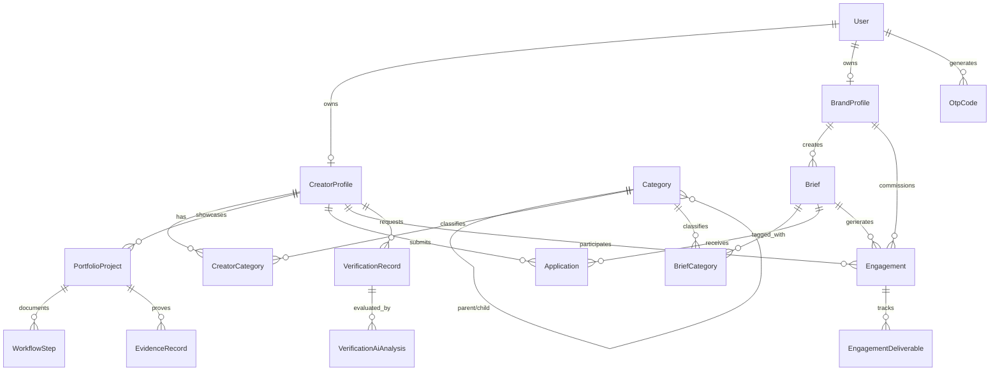

# Phase 0: Database and Migration Architecture Audit
**Project:** Kivora AI Creator-Brand Marketplace  
**Date:** October 12, 2026  
**Auditor:** Kivora Phase 0 Master Audit  

---

## 1. Database Configuration & Engine Analysis

### 1.1 Local Configuration
- **Database Engine:** SQLite (Local Development)
- **Primary Data File:** `kivora.db` (Located at workspace root, size: ~1.4 MB)
- **Backup File Present:** `kivora.db.orig`
- **Connection Configuration (`backend/app/database.py`):**
  ```python
  DATABASE_URL = os.getenv("DATABASE_URL", "sqlite:///./kivora.db")
  # SQLite specific connection flags:
  connect_args = {"check_same_thread": False} if "sqlite" in DATABASE_URL else {}
  engine = create_engine(DATABASE_URL, connect_args=connect_args)
  ```
- **Foreign Key Enforcement:**
  Enforced explicitly via SQLAlchemy event listener on SQLite connection checkout:
  ```python
  @event.listens_for(engine, "connect")
  def set_sqlite_pragma(dbapi_connection, connection_record):
      if "sqlite" in DATABASE_URL:
          cursor = dbapi_connection.cursor()
          cursor.execute("PRAGMA foreign_keys=ON;")
          cursor.close()
  ```
  *Verdict:* Foreign key enforcement is properly enabled for SQLite.

### 1.2 Test Database Isolation
- **Status:** **CRITICAL GAP — No separate test database configured.**
- Currently, executing manual tests or scripts against the backend directly reads and writes to `kivora.db`.
- There is no automated pytest fixture spinning up a transient in-memory SQLite database (`sqlite:///:memory:`) or isolated test database file (e.g. `test_kivora.db`).
- *Risk:* Automated write tests pose a risk of modifying or corrupting existing development seeds.

---

## 2. Migration Architecture & Risks

### 2.1 Current Schema Management
- **Method:** Runtime DDL execution via `Base.metadata.create_all(bind=engine)` inside `backend/app/main.py`.
- **Alembic Status:** **ABSENT**. No `alembic.ini` or `migrations/` directory exists in the codebase.
- **Risk Evaluation: CRITICAL.**
  - `create_all()` creates missing tables when the application starts, but **never alters existing tables**, **never adds missing columns**, **never alters column types**, and **never removes deprecated constraints**.
  - Any future schema change (e.g., adding Stripe payment IDs, adding escrow balances, or changing enum types) will fail silently or crash existing queries unless the database is destroyed and re-seeded, or altered manually via ad-hoc SQL.
  - In a production PostgreSQL deployment, absence of Alembic migrations guarantees downtime and high operational hazard during releases.

### 2.2 SQLite vs. PostgreSQL Parity
1. **Type Differences:**
   - JSON data types (`JSON` in SQLAlchemy) map to plain text in SQLite and native binary `jsonb` in PostgreSQL.
   - Enums: SQLAlchemy handles Enum types natively in PostgreSQL but simulates them with `VARCHAR` and check constraints in SQLite.
2. **Case Sensitivity:**
   - SQLite `LIKE` operator is case-insensitive by default for ASCII text, whereas PostgreSQL `LIKE` is strictly case-sensitive (requiring `ILIKE`). Search queries in `creators.py` and `briefs.py` must use `.ilike()` to prevent cross-engine bugs.
3. **Concurrent Transactions:**
   - SQLite uses file-level locking for writes. High concurrency writes during creator applications or message submissions will experience `database is locked` (`OperationalError`) if deployed in multi-worker ASGI environments.

---

## 3. Read-Only Schema & Baseline Inspection

Direct inspection of `kivora.db` was conducted without modifying data.

### 3.1 Table Row-Count Baseline

| Table Name | Physical Row Count | Description / Role |
| :--- | :---: | :--- |
| `users` | 222 | Authenticated platform identities (Creators, Brands, Admins) |
| `creator_profiles` | 127 | Detailed creator professional profiles |
| `brand_profiles` | 33 | Registered brand and agency profiles |
| `categories` | 97 | 14 parent sectors + 83 specialized subcategories |
| `creator_categories` | 315 | Cross-reference mapping creators to multiple categories |
| `briefs` | 170 | Campaign briefs posted by brands |
| `brief_categories` | 320 | Cross-reference mapping briefs to categories |
| `applications` | 47 | Creator proposals submitted to briefs |
| `engagements` | 30 | Contracted collaborations between brands and creators |
| `engagement_deliverables`| 35 | Milestones, submitted assets, and revision records |
| `portfolio_projects` | 111 | Work samples and case studies uploaded by creators |
| `skills` | 20 | Platform skill tags (Video Editing, 3D CGI, Color Grading, etc.) |
| `creator_skills` | 467 | M2M relationship between creators and skills |
| `brief_skills` | 276 | M2M relationship between briefs and required skills |
| `tools` | 20 | Platform tool tags (Blender, Premiere, Unreal Engine, Midjourney) |
| `creator_tools` | 464 | M2M relationship between creators and tools |
| `brief_tools` | 258 | M2M relationship between briefs and required tools |
| `otp_codes` | 64 | Email verification codes and reset tokens |
| `verification_records` | 7 | Creator identity verification requests |
| `verification_ai_analyses`| 0 | AI portfolio scoring results |
| `workflow_steps` | 14 | Project production process steps |
| `evidence_records` | 7 | Verification document proofs |

---

## 4. Entity-Relationship & Model Structure



---

## 5. Constraint, Indexing & Data Integrity Findings

### 5.1 Indexes Verified
Existing indexed columns verified across `sqlite_master`:
- `users`: `email` (Unique index)
- `creator_profiles`: `handle` (Unique index), `primary_specialization`, `min_budget`, `availability_status`, `verification_tier`
- `brand_profiles`: `slug` (Unique index), `industry`
- `briefs`: `slug` (Unique index), `brand_id`, `status`, `budget_amount`, `content_type`, `deadline`, `aspect_ratio`, `creative_style_mood`
- `categories`: `slug` (Unique index), `name`, `parent_id`
- `applications`: `brief_id`, `creator_id`, `status`
- `engagements`: `brief_id`, `creator_id`, `status`
- `portfolio_projects`: `creator_id`, `slug`, `content_type`, `aspect_ratio`

### 5.2 Indexing & Performance Gaps
1. **Missing Composite Index on Applications:**
   Applications has separate indexes on `brief_id` and `creator_id`. To enforce and speed up unique application checking (`one creator application per brief`), a unique composite index `ix_applications_brief_creator (brief_id, creator_id)` should be added.
2. **Missing Index on Creator Location:**
   Search queries in `creators.py` filter by `location`, but `creator_profiles.location` is not indexed, resulting in full table scans on large datasets.
3. **Potential N+1 Query Risks in Discovery:**
   `get_creators_with_filters` in `creators.py` loads `creator.creator_categories`, `creator.skills`, and `creator.tools`. If not joined with `joinedload()` or `selectinload()`, loading 100 creators triggers 300+ subsequent SQL queries.

---

## 6. Sensitive Data Storage & Deletion Rules

### 6.1 Sensitive Data Review
- **Passwords:** Appropriately hashed using `bcrypt` (stored in `users.hashed_password`). Plaintext passwords are not persisted.
- **OTP Codes:** Stored in plaintext in `otp_codes.code`. While OTPs have an expiration timestamp (`expires_at`), storing them in plaintext allows anyone with database read access to intercept active codes. Recommended: Hash OTP codes or purge immediately upon verification.
- **Payment / Financial Data:** No credit card, bank account, or routing numbers are stored (no payment models exist yet).

### 6.2 Deletion & Cascade Rules
- `CreatorProfile` and `BrandProfile` models use `cascade="all, delete-orphan"` on `User`.
- `PortfolioProject` cascades deletion of `WorkflowStep` and `EvidenceRecord`.
- `Engagement` cascades deletion of `EngagementDeliverable`.
- *Finding:* Deleting a user safely cascades their profile data, but `Brief` deletion when associated `Engagement` records exist needs explicit `RESTRICT` guards to preserve financial and historical collaboration logs.

---

## 7. Recommended Safe Migration Implementation Approach

1. **Initialize Alembic in `backend/`:**
   ```bash
   cd backend
   alembic init --template generic migrations
   ```
2. **Configure `env.py` to import `Base.metadata` from `app.models.models`:**
   Ensure target metadata is pointed to Kivora's SQLAlchemy declarative base.
3. **Generate Initial Baseline Migration (Stamp):**
   ```bash
   alembic revision --autogenerate -m "baseline_marketplace_schema"
   ```
4. **Stamp the Existing Database:**
   ```bash
   alembic stamp head
   ```
   *Crucial rule:* Running `alembic stamp head` marks `kivora.db` as up-to-date without re-executing DDL statements or dropping user data.
5. **Enforce Migrations on Application Startup:**
   Replace `Base.metadata.create_all(bind=engine)` in production with `alembic upgrade head`.
