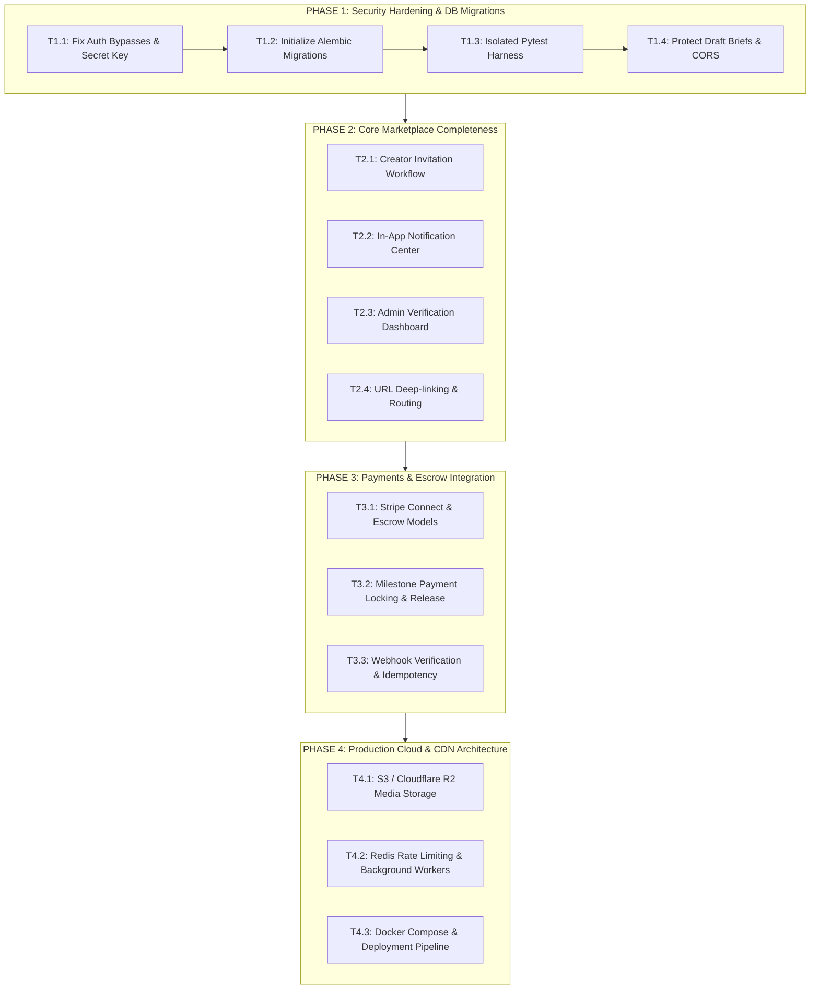

# Phase 0: Implementation Roadmap & Prioritized Task Matrix
**Project:** Kivora AI Creator-Brand Marketplace  
**Date:** October 12, 2026  
**Auditor:** Kivora Phase 0 Master Audit  

---

## 1. Roadmap Architecture & Phased Strategy

Following the findings of the Phase 0 audit, implementation must proceed in a disciplined sequence. Attempting to implement payment escrow or advanced analytics on top of un-migrated schemas with security bypasses creates compound technical debt.

---

## 2. Phase 1: Security Hardening, Database Migrations & Test Isolation (Priority: Immediate)

### Task 1.1: Fix Authentication Bypasses & Strengthen Secrets (P0)
- **Objective:** Eliminate auto-verification vulnerabilities and enforce cryptographic standards.
- **Dependencies:** None.
- **Affected Files:** `backend/app/api/auth.py`, `backend/app/core/security.py`, `backend/.env`.
- **Action Items:**
  1. Update `register()` so new accounts default to `is_email_verified = False`.
  2. Enforce OTP code challenge before issuing active JWT access tokens.
  3. Remove auto-verification side-effects from the `login()` endpoint.
  4. Replace `random.randint` in `generate_otp_code()` with `secrets.randbelow`.
  5. Expand default `SECRET_KEY` to a 64-character cryptographically secure token, eliminating PyJWT `InsecureKeyLengthWarning`.
- **Acceptance Criteria:**
  - Registration returns unverified status and triggers an OTP.
  - Calling protected endpoints with an unverified user returns `403 Forbidden ("Email not verified")`.
  - Zero PyJWT warnings on startup.

---

### Task 1.2: Implement Alembic Database Migrations (P0)
- **Objective:** Transition from volatile `Base.metadata.create_all()` to repeatable, versioned migrations.
- **Dependencies:** Task 1.1.
- **Affected Files:** `backend/alembic.ini`, `backend/migrations/*`, `backend/app/main.py`.
- **Action Items:**
  1. Initialize Alembic within `backend/`.
  2. Configure `env.py` with Kivora's declarative metadata (`Base.metadata`).
  3. Generate baseline revision script matching the current 17 tables.
  4. Execute `alembic stamp head` to mark `kivora.db` without altering existing tables.
  5. Add `UNIQUE(brief_id, creator_id)` index to the `applications` table.
- **Acceptance Criteria:**
  - `alembic check` passes without missing tables or uncommitted migrations.
  - Existing database records (222 users, 170 briefs, 97 categories) remain completely intact.

---

### Task 1.3: Establish Isolated Pytest Test Database Harness (P1)
- **Objective:** Enable safe automated unit and integration tests without touching `kivora.db`.
- **Dependencies:** Task 1.2.
- **Affected Files:** `backend/tests/conftest.py`, `backend/pytest.ini`, `backend/tests/test_auth.py`.
- **Action Items:**
  1. Create a `pytest` test suite configured with an in-memory SQLite fixture (`sqlite:///:memory:`).
  2. Implement client fixtures using `fastapi.testclient.TestClient`.
  3. Add test coverage for auth, role checks, brief creation, and applications.
- **Acceptance Criteria:**
  - Running `pytest backend/tests` executes in < 5 seconds and does not modify `kivora.db`.
  - 100% pass rate across core endpoints.

---

### Task 1.4: CORS Hardening & Confidential Draft Protection (P1)
- **Objective:** Close data leakage vectors on public APIs.
- **Dependencies:** Task 1.1.
- **Affected Files:** `backend/app/main.py`, `backend/app/api/briefs.py`.
- **Action Items:**
  1. Restrict CORS `allow_origins` to explicit whitelist domains.
  2. Modify `GET /api/briefs` to strictly filter `Brief.status == "active"` unless the caller is the owning brand requesting their own drafts.
- **Acceptance Criteria:**
  - Unauthenticated requests to `/api/briefs` return only `active` briefs.
  - Browser console displays no CORS credential warning.

---

## 3. Phase 2: Core Marketplace Completeness (Priority: High)

### Task 2.1: Creator Invitation Workflow
- **Objective:** Allow brands to directly invite creators to active campaign briefs.
- **Dependencies:** Phase 1.
- **Affected Files:** `frontend/src/components/CreatorDiscovery.jsx`, `frontend/src/components/InviteModal.jsx`, `backend/app/api/engagements.py`.
- **Acceptance Criteria:**
  - Brand sees "Invite to Brief" button on `CreatorCard`.
  - Selecting an active brief sends an invitation and provisions an `Engagement` in `invited` status.
  - Creator receives notification in dashboard and can Accept or Decline.

---

### Task 2.2: In-App Notification Center
- **Objective:** Provide a real-time notification inbox for briefs, applications, and deliverable feedback.
- **Dependencies:** Phase 1.
- **Affected Files:** `backend/app/models/models.py`, `backend/app/api/notifications.py`, `frontend/src/components/NotificationBell.jsx`.
- **Acceptance Criteria:**
  - Database schema includes `Notification` table (`user_id`, `title`, `message`, `type`, `is_read`, `created_at`).
  - Top navigation bar displays notification bell with unread badge counter.
  - Clicking item marks as read and navigates to relevant engagement.

---

### Task 2.3: Admin Verification & Moderation Dashboard
- **Objective:** Provide UI for platform administrators to review creator verification requests.
- **Dependencies:** Phase 1.
- **Affected Files:** `frontend/src/components/AdminDashboard.jsx`, `backend/app/api/admin.py`.
- **Acceptance Criteria:**
  - Admin users can log in and view pending verifications.
  - Displays creator portfolio evidence, AI analysis score, and 1-click Approve / Reject action.

---

### Task 2.4: URL Synchronization & Deep-Linking
- **Objective:** Sync active tab state with browser URL to support browser Back/Forward navigation and bookmarking.
- **Dependencies:** None.
- **Affected Files:** `frontend/src/App.jsx`.
- **Acceptance Criteria:**
  - Switching tabs updates URL hash or query params (`/#briefs`, `/#discovery?category=ugc-video`).
  - Refreshing the browser preserves the active view and selected category filters.

---

## 4. Phase 3: Payments, Escrow & Financial Settlement (Priority: Medium)

### Task 3.1: Stripe Connect & Escrow Architecture
- **Objective:** Enable secure brand deposits and creator payouts.
- **Dependencies:** Phase 2.
- **Acceptance Criteria:**
  - Models for `Payment`, `EscrowTransaction`, `PayoutAccount`.
  - Brand deposits brief budget into platform escrow upon accepting creator application.
  - Funds held securely until deliverable approval.

### Task 3.2: Milestone Release & Refund Mechanics
- **Objective:** Automate release of funds upon deliverable sign-off, with dispute mediation.
- **Dependencies:** Task 3.1.
- **Acceptance Criteria:**
  - Brand clicking "Approve Deliverable" triggers webhook payout release to creator Stripe Connect account.
  - Cancellation triggers refund logic according to contract terms.

---

## 5. Phase 4: Production Cloud Infrastructure & Storage (Priority: Medium)

### Task 4.1: Cloud Object Storage (S3 / Cloudflare R2)
- **Objective:** Replace local `./uploads` directory with persistent cloud storage.
- **Dependencies:** Phase 1.
- **Acceptance Criteria:**
  - Backend utilizes S3 pre-signed upload URLs.
  - Assets served through Cloudflare CDN with SSL.

### Task 4.2: Rate Limiting & Asynchronous Workers
- **Objective:** Protect AI and auth endpoints and offload email dispatch to Celery / Redis.
- **Dependencies:** Phase 1.
- **Acceptance Criteria:**
  - `slowapi` rate limits active.
  - Background workers handle heavy tasks (PDF invoice generation, AI scoring).

---

## 6. The Immediate Next Five Tasks

| Step | Task Identifier | Description | Priority | Effort Estimate |
| :---: | :--- | :--- | :---: | :---: |
| **1** | **T1.1: Security & Auth Hardening** | Fix registration auto-verify bypass, upgrade JWT secret to 32+ bytes, and switch OTP generator to `secrets`. | **P0** | 1–2 hours |
| **2** | **T1.2: Alembic Migrations Init** | Initialize Alembic, generate baseline migration matching 17 models, and stamp `kivora.db`. | **P0** | 1–2 hours |
| **3** | **T1.3: Isolated Test Harness** | Set up `pytest` with in-memory SQLite fixture and automated test client. | **P1** | 2–3 hours |
| **4** | **T1.4: Draft Brief Protection & CORS** | Filter draft briefs from public endpoint and configure strict CORS domain whitelist. | **P1** | 1 hour |
| **5** | **T2.1: Creator Invitation Feature** | Build "Invite to Brief" modal in Creator Discovery and wire to backend engagement route. | **P2** | 3–4 hours |
