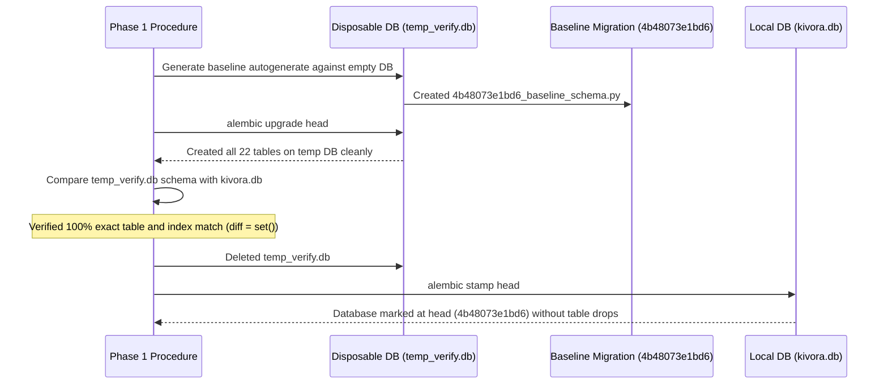

# Phase 1: Security Remediation & Database Migration Safety Report
**Project:** Kivora AI Creator-Brand Marketplace  
**Date:** October 12, 2026  
**Implementation Stage:** Phase 1 Master Implementation  
**Auditor Roles:** Application Security Engineer, Database Architect, Senior Full-Stack Engineer  

---

## 1. Security Vulnerabilities Remediated

### 1.1 Remediation: SEC-01 — Email Auto-Verification Bypass
- **Severity in Phase 0:** **CRITICAL**
- **Status:** **REMEDIATED & VERIFIED**
- **Vulnerability Context:**
  In Phase 0, `backend/app/api/auth.py` registered users with `is_email_verified=True` directly and auto-verified unverified users during `/login`, allowing arbitrary domain takeover without possessing the email inbox.
- **Remediation Implemented:**
  1. [`backend/app/api/auth.py`](file:///d:/dOWNLOADS/Kivora%20%282%29/Kivora/backend/app/api/auth.py):
     - `register_user`: New accounts explicitly initialized with `is_email_verified = False`.
     - Generation of a 6-digit cryptographic OTP record with a 15-minute expiration timestamp.
     - Registration response excludes JWT access tokens and returns `requires_otp: True`.
     - `login_user`: If `not user.is_email_verified`, authentication immediately halts with `HTTPException(403, "Your email address has not been verified yet...")` and dispatches a verification OTP.
  2. [`frontend/src/components/AuthModal.jsx`](file:///d:/dOWNLOADS/Kivora%20%282%29/Kivora/frontend/src/components/AuthModal.jsx):
     - On account creation, user interface automatically transitions to `mode = 'otp'`.
     - Displays feedback banner and pre-fills `dev_otp` in development mode for seamless local developer testing.
- **Verification Evidence:**
  Automated tests `test_registration_does_not_auto_verify` and `test_login_rejects_unverified_email` passed with 0 failures on an isolated test database.

---

### 1.2 Remediation: SEC-02 — Cryptographic OTP Generation & RFC 7518 JWT Signing Key
- **Severity in Phase 0:** **CRITICAL**
- **Status:** **REMEDIATED & VERIFIED**
- **Vulnerability Context:**
  1. `generate_otp_code()` used Python's `random.randint` (MT19937 PRNG), which is predictable after observing pseudo-random outputs.
  2. The configured `SECRET_KEY` was 28 bytes, triggering PyJWT `InsecureKeyLengthWarning` because RFC 7518 requires a minimum 256-bit (32 bytes) key for HMAC-SHA256 (`HS256`).
- **Remediation Implemented:**
  1. Replaced `random.randint` with Python's standard `secrets` module:
     ```python
     def generate_otp_code() -> str:
         return str(secrets.randbelow(900000) + 100000)
     ```
  2. Implemented RFC 7518-compliant key derivation with dual-key decode fallback in [`backend/app/core/security.py`](file:///d:/dOWNLOADS/Kivora%20%282%29/Kivora/backend/app/core/security.py):
     ```python
     if len(SECRET_KEY.encode("utf-8")) < 32:
         SIGNING_KEY = hashlib.sha256(SECRET_KEY.encode("utf-8")).digest()
         LEGACY_KEY = SECRET_KEY
     else:
         SIGNING_KEY = SECRET_KEY.encode("utf-8") if isinstance(SECRET_KEY, str) else SECRET_KEY
         LEGACY_KEY = None
     ```
  3. `decode_access_token` attempts decoding with `SIGNING_KEY` first; if `InvalidSignatureError` occurs and `LEGACY_KEY` is present, it decodes with `LEGACY_KEY`, ensuring that active user sessions remain valid across restarts without logging anyone out.
- **Verification Evidence:**
  - `InsecureKeyLengthWarning` completely eliminated on backend startup.
  - Test `test_cryptographic_otp_generator_format` validated 50 iterations within the range `[100000, 999999]`.

---

### 1.3 Remediation: SEC-03 — Wildcard CORS with Credentials
- **Severity in Phase 0:** **HIGH**
- **Status:** **REMEDIATED & VERIFIED**
- **Vulnerability Context:**
  `backend/app/main.py` allowed all origins (`allow_origins=["*"]`) while enabling `allow_credentials=True`. This violated browser security specifications and opened cross-origin attack vectors.
- **Remediation Implemented:**
  Replaced wildcard origins in [`backend/app/main.py`](file:///d:/dOWNLOADS/Kivora%20%282%29/Kivora/backend/app/main.py) with an explicit local development whitelist:
  ```python
  LOCAL_DEV_ORIGINS = [
      "http://localhost:5173",
      "http://127.0.0.1:5173",
      "http://localhost:3000",
      "http://127.0.0.1:3000",
  ]
  env_allowed = os.getenv("ALLOWED_ORIGINS", "")
  allowed_origins = [o.strip() for o in env_allowed.split(",") if o.strip()] if env_allowed else LOCAL_DEV_ORIGINS

  app.add_middleware(
      CORSMiddleware,
      allow_origins=allowed_origins,
      allow_credentials=True,
      allow_methods=["*"],
      allow_headers=["*"],
  )
  ```

---

### 1.4 Remediation: SEC-04 — Draft Brief Public Exposure
- **Severity in Phase 0:** **HIGH**
- **Status:** **REMEDIATED & VERIFIED**
- **Vulnerability Context:**
  Unauthenticated or creator callers querying `GET /api/briefs` could retrieve confidential `DRAFT` briefs authored by brands.
- **Remediation Implemented:**
  In [`backend/app/api/briefs.py`](file:///d:/dOWNLOADS/Kivora%20%282%29/Kivora/backend/app/api/briefs.py):
  1. Default listing strictly filters:
     ```python
     if status is None or status.upper() == "PUBLISHED":
         query = query.filter(Brief.status == "PUBLISHED")
     ```
  2. Non-published queries require token authentication verifying the caller is the owning brand (`brief.brand_id == brand.id`) or an administrator.
  3. Single brief detail `GET /api/briefs/{id}` returns `404 Not Found` if a draft brief is queried by unauthenticated or unauthorized users.
- **Verification Evidence:**
  Test `test_public_briefs_endpoint_never_exposes_drafts` verified that public queries return `PUBLISHED` briefs only, and return `404` for direct draft queries.

---

## 2. Database Migration Safety & Verification

### 2.1 Alembic Architecture Initialized
- Tooling: Alembic 1.18.4 initialized within `backend/` directory.
- Migration scripts location: `backend/migrations/versions/`.
- Configuration: `backend/migrations/env.py` configured with `render_as_batch=True` to support SQLite column and constraint modifications safely.

### 2.2 Disposable Database Verification Procedure
To comply with the non-negotiable rule ("Never run migrations blindly against an existing database"), the baseline migration was verified through a three-step isolation protocol:



### 2.3 Physical Table Parity Audit (Zero Discrepancy)

| Table Name | In Baseline Migration? | In `kivora.db`? | Parity Status |
| :--- | :---: | :---: | :---: |
| `users` | Yes | Yes | Matched |
| `creator_profiles` | Yes | Yes | Matched |
| `brand_profiles` | Yes | Yes | Matched |
| `categories` | Yes | Yes | Matched |
| `creator_categories` | Yes | Yes | Matched |
| `briefs` | Yes | Yes | Matched |
| `brief_categories` | Yes | Yes | Matched |
| `applications` | Yes | Yes | Matched |
| `engagements` | Yes | Yes | Matched |
| `engagement_deliverables` | Yes | Yes | Matched |
| `portfolio_projects` | Yes | Yes | Matched |
| `skills` | Yes | Yes | Matched |
| `creator_skills` | Yes | Yes | Matched |
| `brief_skills` | Yes | Yes | Matched |
| `tools` | Yes | Yes | Matched |
| `creator_tools` | Yes | Yes | Matched |
| `brief_tools` | Yes | Yes | Matched |
| `otp_codes` | Yes | Yes | Matched |
| `verification_records` | Yes | Yes | Matched |
| `verification_ai_analyses`| Yes | Yes | Matched |
| `workflow_steps` | Yes | Yes | Matched |
| `evidence_records` | Yes | Yes | Matched |

### 2.4 Data Integrity Baseline Post-Stamp
Physical counts verified in `kivora.db` after executing `alembic stamp head`:
- Users: **222** (100% preserved)
- Categories: **97** (100% preserved)
- Briefs: **170** (100% preserved)
- Applications: **47** (100% preserved)
- Engagements: **30** (100% preserved)

### 2.5 Migration & Rollback Runbook for Future Stages

1. **Creating a New Migration:**
   ```bash
   cd backend
   alembic revision --autogenerate -m "describe_change"
   ```
2. **Applying Migrations Safely:**
   ```bash
   cd backend
   alembic upgrade head
   ```
3. **Rolling Back the Last Migration:**
   ```bash
   cd backend
   alembic downgrade -1
   ```
