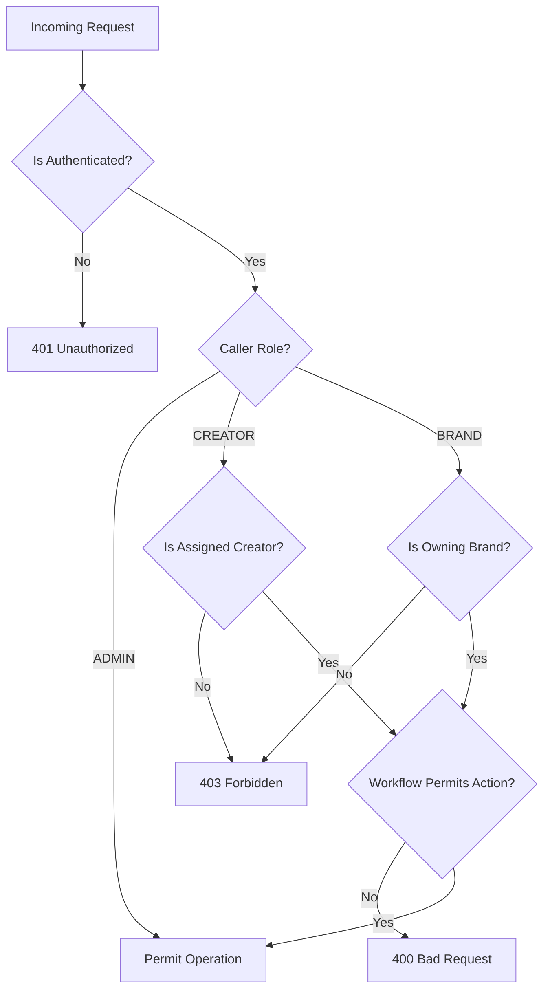

# KIVORA — PHASE 3 SECURITY AND FILE STORAGE SPECIFICATION
## Upload Validation, Download Authorization, Version Immutability & AI Defenses

---

## 1. File Storage Architecture

### 1.1 Local Storage Layout
Deliverable assets are stored outside the public frontend root directory to prevent unauthenticated direct URL access:
```
backend/uploads/
  └── deliverables/
        ├── {uuid4}_{sanitized_basename}.png
        ├── {uuid4}_{sanitized_basename}.mp4
        └── ...
```

### 1.2 Separation of Binary Storage & Relational Metadata
- Binary payloads are written directly to disk using chunked streaming buffers (`64 KB` chunks) to prevent loading large assets entirely into RAM.
- Relational metadata (`file_storage_key`, `original_filename`, `file_size_bytes`, `content_type`, `sha256_checksum`) is stored in the database.
- Physical storage keys are never exposed directly to clients; clients only interact with authorization-guarded download URLs: `/api/workspaces/{id}/deliverables/{deliverable_id}/download`.

---

## 2. File Validation & Defensive Controls

### 2.1 File Size Bounds
- Hard upload limit: `50 MB` (configurable via `MAX_DELIVERABLE_SIZE`).
- Enforced on-the-fly during streaming reads: if byte count exceeds limit, file buffer is immediately closed, temporary storage file unlinked, and `HTTP 413 Payload Too Large` returned.

### 2.2 Allowed File Types & Extensions
Permitted extensions are strictly whitelisted:
- **Images:** `.jpg`, `.jpeg`, `.png`, `.webp`, `.gif`
- **Video:** `.mp4`, `.webm`, `.mov`
- **Documents & Data:** `.pdf`, `.txt`, `.json`, `.zip`
- **3D & Generative:** `.blend`, `.usd`, `.usdz`

Files with forbidden or executable extensions (`.exe`, `.sh`, `.bat`, `.py`, `.js`, `.html`, `.svg`) are rejected with `HTTP 400 Bad Request`.

### 2.3 Path Traversal Neutralization
- User-provided filenames are sanitized using `Path(file.filename).name`, which discards any leading directory traversal sequences (`../../`, `..\..\`).
- The stored file key is prefixed with a cryptographically unique `uuid4().hex` to prevent collisions and overwrite exploits.

### 2.4 Cryptographic Checksum (SHA-256)
- Every uploaded deliverable version is hashed with streaming SHA-256 during upload.
- The resulting digest is stored in `engagement_deliverables.sha256_checksum`.
- Used for tamper-detection, version comparison diffs, and verification of asset provenance.

---

## 3. Authorization & Access Control

Every collaboration endpoint implements a 6-point verification sequence in `CollaborationService.verify_participant`:



### 3.1 IDOR Prevention
- Users cannot access another party's workspace, download files, or inspect reviews by enumerating `engagement_id` or `deliverable_id`.
- The database relationship is verified against the authenticated user's profile ID (`creator_profiles.id == engagement.creator_id` or `brand_profiles.id == engagement.brief.brand_id`).

### 3.2 Tenant Isolation
- `GET /api/workspaces/history/brand` filters strictly by the authenticated brand profile. Brand A can never discover Brand B's engagements.
- `GET /api/workspaces/history/creator` filters strictly by the authenticated creator profile. Creator A can never discover Creator B's engagements.

### 3.3 Protected File Downloads
- Direct file downloads execute `download_deliverable_file`:
  1. Finds engagement and verifies caller is an active participant or admin.
  2. Finds deliverable belonging specifically to that engagement.
  3. Verifies physical file exists on disk.
  4. Returns `FileResponse` with safe `Content-Disposition` header using the sanitized original filename.

---

## 4. Version Immutability & Lifecycle Rules

1. **Non-destructive Versioning:** Uploading version $N+1$ never modifies, truncates, or deletes the binary file or database row for version $N$.
2. **Server-Generated Ordering:** Version numbers are computed server-side (`MAX(version) + 1`).
3. **Approval Immutability:** An approved deliverable version cannot be rewritten.
4. **Approval Authorization:** Only the Brand owner or an Admin can approve a deliverable. Creators cannot approve their own submissions.
5. **Completion Guard:** An engagement cannot be marked `COMPLETED` unless the latest deliverable is `APPROVED`.

---

## 5. AI Review Quality Analysis & Prompt Injection Defenses

### 5.1 Untrusted Input Sanitization
- User-provided text (submission notes, filenames, brief descriptions) is treated as untrusted data, never as system instructions.
- System instructions are strictly isolated from user content.
- Evaluated against mock and local heuristic evaluators with bound size checks.

### 5.2 Non-Authoritative AI Guarantee
- AI analysis results are explicitly advisory and informative.
- **Rule:** AI output can NEVER alter the deliverable status, approve a deliverable, request revisions, or complete an engagement.
- Human brand reviewers retain sole approval authority.
