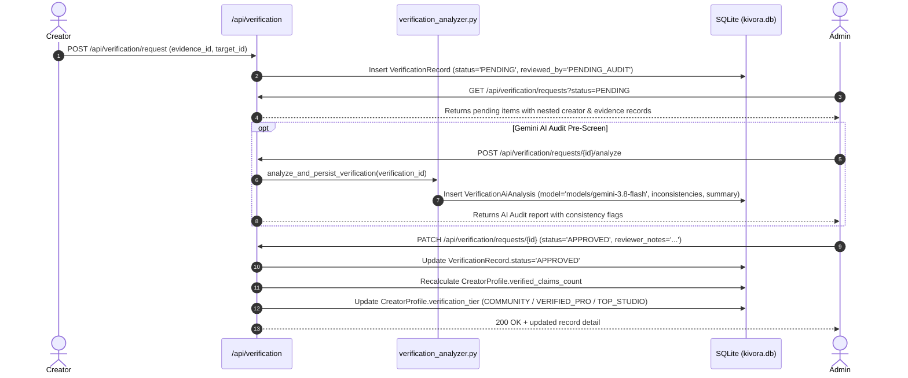

# KIVORA ADMIN PORTAL AUDIT
**Navigation Verification, Verification Flow Trace, and Discrepancy Resolution**

---

## 1. Sidebar Navigation & Deep-Link Architecture

The Admin Portal is housed in [AdminDashboard.jsx](file:///d:/dOWNLOADS/Kivora/frontend/src/components/AdminDashboard.jsx) and delegates view rendering to 6 modular sub-views located in `frontend/src/components/admin/`:

```
AdminDashboard.jsx
  ├── [tab=overview]   -> AdminOverviewView.jsx     (KPI Cards & Recent Submissions)
  ├── [tab=requests]   -> AdminVerificationView.jsx  (Verification Queue & Decision Drawer)
  ├── [tab=creators]   -> AdminCreatorsView.jsx      (131 Creator Directory & Stats)
  ├── [tab=reports]    -> AdminReportsView.jsx       (Analytics, Approval Rates, Backlog)
  ├── [tab=audit]      -> AdminAuditLogView.jsx      (9 Historical Human/AI Decisions)
  └── [tab=settings]   -> AdminSettingsView.jsx      (Gemini Model Config & Env Info)
```

### Verified Navigation & History Mechanics:
- **URL Synchronization:** Navigating between tabs executes `window.history.pushState({}, '', url.toString())`, updating `?tab=<tab_id>`.
- **Deep-Linking:** Loading `http://localhost:5173/?tab=requests` directly opens the Verification Requests view.
- **Browser Back/Forward:** Supported via `popstate` event listeners in [App.jsx](file:///d:/dOWNLOADS/Kivora/frontend/src/App.jsx#L234-L260).
- **Page Refresh:** Retains active view by parsing `new URLSearchParams(window.location.search).get('tab')`.

---

## 2. Status of the Zero-Data Discrepancy (Phase 1.5 Repair)

| Diagnostic Point | Phase 1 Status | Defect Condition Reported | Verified Post-Repair State |
| :--- | :--- | :--- | :--- |
| **Verification Requests Count** | 12 records reported | UI showed `0` | **12 records** displayed with full status badges |
| **Creator Directory Count** | 131 creators reported | UI showed unhandled state | **131 creator cards** rendered with filters |
| **Approval Rate Metric** | 77.8% | UI showed `0.0%` | **77.8% (7 / 9 decided)** accurately calculated |
| **Rejection Rate Metric** | 22.2% | UI showed `0.0%` | **22.2% (2 / 9 decided)** accurately calculated |
| **Backlog Ratio Metric** | 25.0% | UI showed `0.0%` | **25.0% (3 / 12 total)** accurately calculated |
| **AI Audit Coverage** | 50.0% | UI showed `0.0%` | **50.0% (6 / 12 total)** accurately calculated |
| **Audit Log Decisions** | 9 decisions | UI showed empty table | **9 real human/AI decision rows** rendered |
| **Failure Representation** | Swallowed errors | Swallowed into empty array `[]` | **Persistent error banner**, `—` for metrics, **Retry** & **Admin Sign-In** recovery buttons |

---

## 3. End-to-End Verification Flow Trace



---

## 4. Platform Settings & Gemini AI Configuration

In [AdminSettingsView.jsx](file:///d:/dOWNLOADS/Kivora/frontend/src/components/admin/AdminSettingsView.jsx#L110):
- **Model Display:** Configured to `gemini-3.8-flash`.
- **Backend Sync:** Exactly matches `GEMINI_MODEL = os.getenv("GEMINI_MODEL", "gemini-3.8-flash")` in [config.py](file:///d:/dOWNLOADS/Kivora/backend/app/core/config.py#L35).
- **Database Alignment:** Every analysis record in `verification_ai_analyses` records `model_name = 'models/gemini-3.8-flash'`.
- **Key Security:** API key status is checked via `is_gemini_configured()` boolean check; key string is never displayed or leaked.
