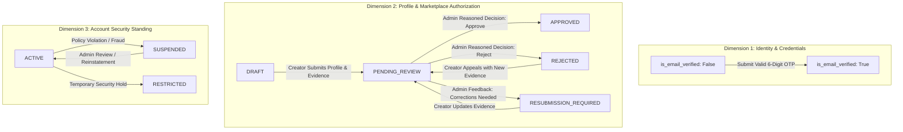

# KIVORA CREATOR VERIFICATION STATE MACHINE
**Lifecycle Specification, State Dimensions, and Data Migration Policy**

---

## 1. Architectural Need for Separate Status Dimensions

The audit revealed that Kivora currently uses `User.is_email_verified` (boolean) and `CreatorProfile.verification_tier` (`COMMUNITY`, `VERIFIED_PRO`, `TOP_STUDIO`).

Because `verification_tier` defaults to `"COMMUNITY"`, an account that has merely completed an email OTP is treated as active. There is **no profile verification dimension** to distinguish a creator who is drafting their portfolio from one pending administrative review or approved for brand engagements.

### Three Distinct Architectural Dimensions:



1. **Email Verification (`User.is_email_verified: Boolean`):**
   - Confirms user controls the registered email address.
   - **Crucial Rule:** Email verification alone **never** implies marketplace authorization.
2. **Profile Verification (`CreatorProfile.profile_status: String`):**
   - Governs creator eligibility to appear in public search, submit pitches on brand briefs, and message brands.
   - Values: `DRAFT`, `PENDING_REVIEW`, `APPROVED`, `REJECTED`, `RESUBMISSION_REQUIRED`.
3. **Account Standing (`User.account_status: String`):**
   - System-wide security status. Values: `ACTIVE`, `RESTRICTED`, `SUSPENDED`.

---

## 2. Minimal Safe Schema Recommendation

To avoid destructive table rewrites, the smallest safe schema enhancement adds one column to `creator_profiles` and one to `users`:

```sql
-- Non-destructive addition to Creator Profiles
ALTER TABLE creator_profiles ADD COLUMN profile_status VARCHAR(30) NOT NULL DEFAULT 'DRAFT';

-- Non-destructive addition to Users
ALTER TABLE users ADD COLUMN account_status VARCHAR(20) NOT NULL DEFAULT 'ACTIVE';
```

Existing foreign keys, relationships, and queries remain intact.

---

## 3. Comprehensive State Transition Matrix

| Transition | From State | To State | Initiator | Required Conditions & Validations | Consequence & Feature Effect |
| :--- | :--- | :--- | :--- | :--- | :--- |
| **T1: Verify Email** | Unverified | `DRAFT` | Creator | Submits valid, unexpired OTP code. | Grants access to profile setup dashboard. Locked from marketplace features. |
| **T2: Submit Profile** | `DRAFT` | `PENDING_REVIEW` | Creator | Profile complete: bio (&ge; 20 chars), avatar, primary specialization, &ge; 1 portfolio project, &ge; 1 evidence record. | Locks profile from editing; triggers `PROFILE_SUBMITTED` notification; enqueues admin review. |
| **T3: Admin Approval** | `PENDING_REVIEW` | `APPROVED` | Administrator | Human admin decision with reviewer notes and selected approval tier. | Unlocks brief browsing, pitching, messaging; adds to public creator directory; dispatches approval email. |
| **T4: Admin Rejection** | `PENDING_REVIEW` | `REJECTED` | Administrator | Human admin decision with mandatory rejection reason and improvement guidelines. | Keeps marketplace features locked; renders actionable rejection view with feedback. |
| **T5: Request Changes** | `PENDING_REVIEW` | `RESUBMISSION_REQUIRED` | Administrator | Human admin decision with specific list of deficient evidence items. | Profile becomes editable again; displays admin correction checklist on dashboard. |
| **T6: Resubmission** | `RESUBMISSION_REQUIRED` or `REJECTED` | `PENDING_REVIEW` | Creator | Replaced/updated evidence record and explanation text. | Re-locks profile; notifies administrator of resubmitted audit. |
| **T7: Account Suspension**| Any | `SUSPENDED` | Administrator | Documented terms of service violation or detected fraud. | Immediate token revocation; access denied across all endpoints (HTTP 403). |

---

## 4. Existing Creator Record Migration Policy

The active database `kivora.db` contains **206 creator profiles** (131 non-test public creators, 75 test accounts).

> [!IMPORTANT]
> **Safety Rule:** Existing creators must **not** be indiscriminately marked `APPROVED` without an explicit, auditable migration policy.

### Proposed 4-Tier Migration Policy:

```
[Existing Creator Inventory: 206 Profiles]
  ├── Category A: Seed Verified Creators (69 profiles)
  │     ├── Criteria: Non-test handle, verification_tier IN ('VERIFIED_PRO', 'TOP_STUDIO'), verified_claims_count > 0
  │     └── Migration Action: Set profile_status = 'APPROVED' (Preserves seed marketplace ecosystem)
  ├── Category B: Established Community Creators with Portfolio (62 profiles)
  │     ├── Criteria: Non-test handle, verification_tier = 'COMMUNITY', portfolio_projects.count > 0
  │     └── Migration Action: Set profile_status = 'APPROVED' with audit note 'LEGACY_MIGRATED'
  ├── Category C: Incomplete Community Registrants (2 profiles)
  │     ├── Criteria: Non-test handle, verification_tier = 'UNVERIFIED' or 0 portfolio projects
  │     └── Migration Action: Set profile_status = 'DRAFT' (Prompts user to complete profile upon next sign-in)
  └── Category D: Automated Test Accounts (73 profiles)
        ├── Criteria: handle LIKE 'test_%' or display_name LIKE 'test_%'
        └── Migration Action: Set profile_status = 'DRAFT' (Excluded from public discovery)
```

This policy guarantees that active marketplace seed data and brand demo workflows continue working seamlessly while cleanly subjecting new accounts to the verified onboarding state machine.
