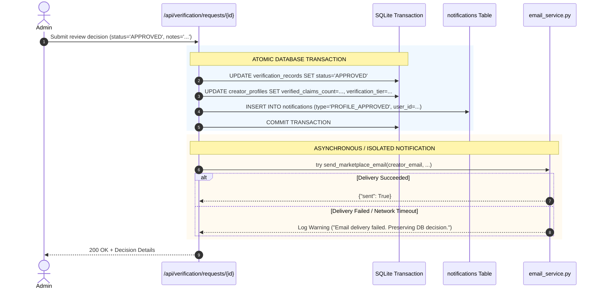

# KIVORA EMAIL AND NOTIFICATION AUDIT
**Provider Architecture, Transactional Isolation, and Notification Lifecycle**

---

## 1. Current Email Engine & Configuration Architecture

The email subsystem is implemented in [email_service.py](file:///d:/dOWNLOADS/Kivora/backend/app/services/email_service.py). It implements a resilient multi-tier fallback architecture:

```
[Email Dispatch Request]
        │
        ▼
Is RESEND_API_KEY Configured?
 ├── YES ──> Attempt HTTP POST to https://api.resend.com/emails
 │             ├── Success (200/201) ──> Return delivered
 │             └── Failure ────────────> Log warning, fall back to SMTP
 └── NO
        │
        ▼
Is SMTP Fully Configured? (HOST, PORT, USER, PASSWORD)
 ├── YES ──> Attempt smtplib TLS dispatch (Gmail/SES/Brevo)
 │             ├── Success ────────────> Return delivered
 │             └── Failure / Quota ────> Fall back to Dev Mode
 └── NO
        │
        ▼
Is Environment Non-Production? (KIVORA_ENV != "production")
 ├── YES ──> Log to Console: "==> [DEV/FALLBACK OTP] ...", Return dev_otp
 └── NO  ──> Raise ValueError("Missing required SMTP configuration")
```

### Verified Active Configuration Status:
- `RESEND_API_KEY`: Not configured in local `.env`.
- `SMTP_USER`: Not configured in local `.env` (`SMTP_HOST=smtp.gmail.com`, but credentials absent).
- `KIVORA_ENV`: Set to `"development"`.
- **Confirmed Result:** All registration and password reset OTP requests safely route to `dev_fallback`. The application logs the OTP code and returns it in the API response payload, allowing seamless local development without risk of failed network requests or sending emails to third parties.

---

## 2. Event-Driven Notification Specification

To support the creator onboarding state machine, 6 event-driven notifications must be defined across in-app alerts and transactional email:

| Event Identifier | Trigger Endpoint | Primary Recipient | Delivery Channels | Email Content Summary | In-App Alert |
| :--- | :--- | :--- | :--- | :--- | :---: |
| **`AUTH_OTP_DISPATCH`** | `POST /api/auth/register` | Registrant | Email only | 6-digit numeric OTP code, 15-minute expiration warning. | ❌ |
| **`EMAIL_VERIFIED`** | `POST /api/auth/verify-otp` | User | Email | Confirmation of verified email address and link to complete profile. | ✅ |
| **`PROFILE_SUBMITTED`**| Creator profile submit | Creator | Email + In-App | Confirmation that profile and evidence have been queued for admin review. | ✅ |
| **`PROFILE_APPROVED`** | Admin review patch | Creator | Email + In-App | Approval announcement, assigned verification tier, marketplace unlock links. | ✅ |
| **`PROFILE_REJECTED`** | Admin review patch | Creator | Email + In-App | Reasoned feedback, specific deficiencies, and actionable correction link. | ✅ |
| **`PROFILE_RESUBMITTED`**| Creator resubmission | Administrator | In-App + Admin Queue | Alert to admin team that creator has provided updated evidence for review. | ✅ |

---

## 3. Transactional Safety & Failure Isolation Rules

> [!CRITICAL]
> **Safety Rule:** Email delivery must **never** govern the database transaction. If email delivery fails, the underlying administrative decision or user registration must remain committed.



### Safety Rules Enforced:
1. **Commit First:** All state mutations and in-app notifications must be committed to `kivora.db` before calling the email transport.
2. **Failure Isolation:** The email call is wrapped in a dedicated `try/except` block. A network timeout or SMTP rejection logs a warning and does not raise an unhandled exception or trigger a rollback.
3. **No Sensitive AI Findings in Client Logs:** Internal AI audit flags, raw model prompts, and internal confidence scores are excluded from email bodies and log files.
4. **No Unachievable SLA Promises:** Email templates must **not** promise fixed turnaround times (e.g. "We will review your profile in 24 hours") unless an enforceable SLA exists. Templates state: *"Your profile is in the administrative review queue. You will receive an email once evaluated."*
