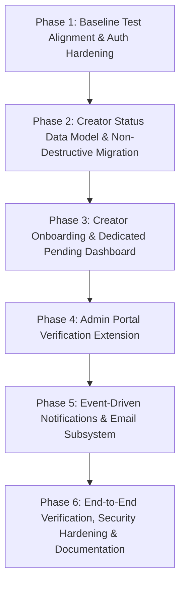

# KIVORA PHASED IMPLEMENTATION ROADMAP
**Engineering Roadmap, Dependencies, Acceptance Criteria, and Safety Protocols**

---

## 1. Roadmap Overview & Dependency Architecture

This roadmap establishes a dependency-ordered, non-destructive path to implement the complete creator onboarding and profile verification lifecycle while strictly preserving all existing marketplace operations, brand workflows, and database records.

---

## Phase 1: Baseline Test Alignment & Authentication Hardening

### Objective & Business Value
Achieve a 100% green automated test baseline (123/123 passing), eliminate string discrepancies between auth routes and test assertions, and harden client-side authentication to prevent cross-role token desynchronization.

### Confirmed Current-State Findings Addressed
1. `backend/tests/test_auth_extensive.py::test_login_unverified_account` fails due to phrasing mismatch in HTTP 403 error message.
2. `backend/tests/test_phase5_matching.py::test_hard_filter_content_type_mismatch` fails due to gap string mismatch.
3. Cross-role token collision in `localStorage` caused the Phase 1.5 zero-data bug.

### Scope
- **Backend:** Harmonize HTTP 403 error detail in [auth.py](file:///d:/dOWNLOADS/Kivora/backend/app/api/auth.py#L468) and [test_auth_extensive.py](file:///d:/dOWNLOADS/Kivora/backend/tests/test_auth_extensive.py#L54). Align test assertion in [test_phase5_matching.py](file:///d:/dOWNLOADS/Kivora/backend/tests/test_phase5_matching.py#L230).
- **Frontend:** Update [authService.js](file:///d:/dOWNLOADS/Kivora/frontend/src/services/authService.js) to atomically validate token role on app startup and clear stale storage upon role mismatch.
- **Database:** Zero changes.
- **Email:** Zero changes.

### Affected Files
- `backend/app/api/auth.py`
- `backend/tests/test_auth_extensive.py`
- `backend/tests/test_phase5_matching.py`
- `frontend/src/services/authService.js`

### Acceptance Criteria & Definition of Done
- `pytest backend/tests/` passes with **123 passed, 0 failed**.
- Switching users across `ADMIN`, `CREATOR`, and `BRAND` in the browser triggers clean session switches without 401/403 collisions.
- Rollback: Revert single-line edits in `auth.py` and test files.

---

## Phase 2: Creator Status Data Model & Non-Destructive Migration

### Objective & Business Value
Introduce the `profile_status` and `account_status` conceptual dimensions into SQLAlchemy models and execute a reviewed, non-destructive SQLite migration preserving all 206 existing creator profiles.

### Confirmed Current-State Findings Addressed
1. `CreatorProfile` currently lacks a status dimension to distinguish `DRAFT`, `PENDING_REVIEW`, and `APPROVED`.
2. Existing 131 public creators must remain accessible to brand workflows without indiscriminate bulk approval.

### Scope
- **Database:** Add columns `profile_status VARCHAR(30)` to `creator_profiles` and `account_status VARCHAR(20)` to `users`.
- **Migration Policy:** Execute explicit 4-tier migration script:
  - Seed verified creators (69): `profile_status = 'APPROVED'`.
  - Established community creators with portfolio (62): `profile_status = 'APPROVED'`.
  - Incomplete community creators (2): `profile_status = 'DRAFT'`.
  - Automated test accounts (73): `profile_status = 'DRAFT'`.
- **Backend:** Update [models.py](file:///d:/dOWNLOADS/Kivora/backend/app/models/models.py) and Pydantic schemas. Add `require_approved_creator` dependency in [deps.py](file:///d:/dOWNLOADS/Kivora/backend/app/core/deps.py).

### Affected Files
- `backend/app/models/models.py`
- `backend/app/schemas/schemas.py`
- `backend/app/core/deps.py`
- `backend/migrations/` (or non-destructive sqlite schema update script)

### Acceptance Criteria & Definition of Done
- Database contains new columns with PRAGMA integrity intact.
- Existing 131 creators remain discoverable via `GET /api/creators`.
- `require_approved_creator` correctly permits approved creators and denies draft/pending creators.
- Rollback: SQLite table column drop or restore from pre-phase backup copy.

---

## Phase 3: Creator Onboarding & Dedicated Pending Dashboard

### Objective & Business Value
Enforce creator profile completion requirements, provide an intuitive profile submission flow, and display a dedicated Pending Verification Dashboard while restricting unapproved accounts from marketplace operations.

### Confirmed Current-State Findings Addressed
1. Newly registered creators currently bypass approval and access all marketplace actions immediately.
2. Creators awaiting review have no visual guidance or timeline feedback.

### Scope
- **Backend:** Implement `POST /api/creators/profile/submit` enforcing minimum requirements: display name, bio, avatar, primary specialization, &ge; 1 portfolio project, &ge; 1 evidence record.
- **Frontend:**
  - Create `PendingVerificationView.jsx` component displaying submission timestamp, checklist, and withdraw/edit options.
  - In [CreatorDashboard.jsx](file:///d:/dOWNLOADS/Kivora/frontend/src/components/CreatorDashboard.jsx), conditionally render `PendingVerificationView` when `profile_status === 'PENDING_REVIEW'`.
  - Gate "Apply to Brief" button in [BriefDetailModal.jsx](file:///d:/dOWNLOADS/Kivora/frontend/src/components/BriefDetailModal.jsx) and Messaging if creator is not approved.

### Affected Files
- `backend/app/api/creators.py`
- `frontend/src/components/CreatorDashboard.jsx`
- `frontend/src/components/BriefDetailModal.jsx`
- `frontend/src/components/PendingVerificationView.jsx` (New)

### Acceptance Criteria & Definition of Done
- Newly registered creator sees Setup mode, uploads portfolio, and submits profile.
- Status updates to `PENDING_REVIEW`; Pending Dashboard renders with checklist.
- Attempting to pitch on a brief via UI or direct API returns HTTP 403 with useful guidance.
- Rollback: Feature flag disabling frontend pending view routing.

---

## Phase 4: Admin Portal Verification Extension

### Objective & Business Value
Enable administrators to review complete creator onboarding submissions alongside individual portfolio evidence claims, record reasoned decisions, and communicate actionable corrections.

### Confirmed Current-State Findings Addressed
1. Admin Portal currently only reviews individual `evidence_records`, lacking a profile onboarding review queue.
2. Admins cannot request evidence resubmission from creators.

### Scope
- **Backend:** Implement `GET /api/verification/creator-profiles` and `PATCH /api/verification/creator-profiles/{id}` with mandatory `reviewer_notes` and status (`APPROVED`, `REJECTED`, `RESUBMISSION_REQUIRED`).
- **Frontend:**
  - Extend [AdminVerificationView.jsx](file:///d:/dOWNLOADS/Kivora/frontend/src/components/admin/AdminVerificationView.jsx) with a secondary tab: "Creator Onboarding Queue".
  - Build detail drawer showing creator identity, bio, full portfolio projects, attached evidence, and decision form.

### Affected Files
- `backend/app/api/verification.py`
- `frontend/src/components/admin/AdminVerificationView.jsx`

### Acceptance Criteria & Definition of Done
- Admin can filter onboarding requests by status (Pending, Approved, Rejected, Changes Requested).
- Approving a creator updates `profile_status = 'APPROVED'`, immediately unlocking the creator's portal on next fetch.
- Rejection or change requests update creator status and provide feedback.
- Rollback: Revert frontend tab extension in `AdminVerificationView.jsx`.

---

## Phase 5: Event-Driven Notifications & Email Subsystem

### Objective & Business Value
Deliver transactional emails and in-app notifications on registration, submission, approval, and rejection without coupling delivery failures to database transactions.

### Confirmed Current-State Findings Addressed
1. Admin verification decisions currently generate zero notifications or emails.
2. Email dispatch errors must be isolated to prevent database transaction rollbacks.

### Scope
- **Backend:**
  - Implement email templates for `PROFILE_SUBMITTED`, `PROFILE_APPROVED`, and `PROFILE_REJECTED` in [email_service.py](file:///d:/dOWNLOADS/Kivora/backend/app/services/email_service.py).
  - Automatically create in-app notification records in `notifications` table on administrative decisions.
  - Enforce try/except isolation: database commit executes first; email failure logs warning and does not reverse decision.

### Affected Files
- `backend/app/services/email_service.py`
- `backend/app/services/notification_service.py`
- `backend/app/api/verification.py`

### Acceptance Criteria & Definition of Done
- Admin decision creates an in-app notification row in `notifications`.
- Email service dispatches branded HTML email (or safe dev log in non-prod).
- Simulating email failure (invalid credentials) preserves the admin approval in database.
- Rollback: Disable email dispatch flag in verification router.

---

## Phase 6: End-to-End Regression, Security Polish & Documentation

### Objective & Business Value
Verify full marketplace integrity across creator, brand, and admin roles; conduct automated browser testing; and finalize documentation.

### Scope
- **End-to-End Browser Testing:** Automated browser subagent validates full lifecycle from registration &rarr; OTP &rarr; DRAFT &rarr; Submission &rarr; Admin Review &rarr; Approval &rarr; Marketplace Pitch.
- **Regression Checks:** Brand campaign brief publishing, creator applications, collaborative workspaces, and direct messaging verified intact.
- **Security Audit:** Rate limiting configured on auth endpoints; magic byte validation added to media upload.
- **Documentation:** Final completion sign-off recorded.

### Acceptance Criteria & Definition of Done
- 100% of automated backend tests pass.
- Frontend production build (`npm run build`) completes with 0 errors.
- ESLint reports 0 errors.
- Existing brand directory (33 brands) and active briefs (171 briefs) operate without regressions.
