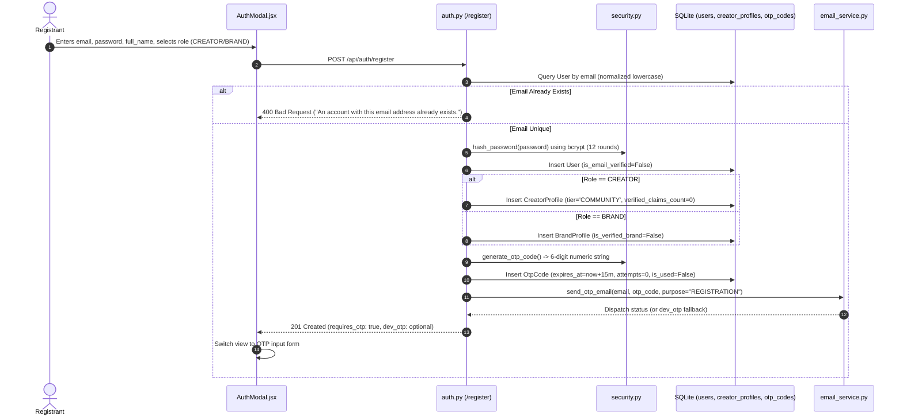

# KIVORA REGISTRATION AND AUTHENTICATION AUDIT
**End-to-End Trace, Security Analysis, and Workflow Defect Audit**

---

## 1. Registration Pathways Trace

Registration is initiated in [AuthModal.jsx](file:///d:/dOWNLOADS/Kivora/frontend/src/components/AuthModal.jsx#L77-L105) and serviced by `POST /api/auth/register` in [auth.py](file:///d:/dOWNLOADS/Kivora/backend/app/api/auth.py#L76-L185).

### Confirmed Code Details:
- **Email Normalization:** `email = payload.email.lower().strip()` in [auth.py](file:///d:/dOWNLOADS/Kivora/backend/app/api/auth.py#L79). Prevents case-sensitivity duplicates.
- **Role Validation:** Enforces `role in ["CREATOR", "BRAND"]`. Admin accounts cannot be self-registered via public API.
- **Instant Profile Creation:** A default `CreatorProfile` or `BrandProfile` is instantiated synchronously during registration.

---

## 2. Email OTP Mechanics & Security Parameters

All OTP codes are managed through the `otp_codes` table and validated in `POST /api/auth/verify-otp` in [auth.py](file:///d:/dOWNLOADS/Kivora/backend/app/api/auth.py#L187-L256).

| Parameter | Configuration | Verification Rule & Enforcement |
| :--- | :--- | :--- |
| **Code Generation** | Cryptographic secrets | [security.py](file:///d:/dOWNLOADS/Kivora/backend/app/core/security.py#L90): `secrets.randbelow(900000) + 100000` generates a secure 6-digit numeric code. |
| **Code Expiration** | 15 Minutes | Enforced via `datetime.utcnow() > otp_record.expires_at` &rarr; `400 Bad Request`. |
| **Single-Use Guard** | Atomic Flag | Once verified, `otp_record.is_used = True` is committed immediately with `user.is_email_verified = True`. Replay attempts fail with `400 Bad Request`. |
| **Brute-Force Guard**| 5 Maximum Attempts | Each invalid attempt increments `otp_record.attempts += 1`. If attempts reach 5, `otp_record.is_used = True` is marked invalid, locking the code. |
| **Resend Cooldown** | 60 Seconds | [auth.py](file:///d:/dOWNLOADS/Kivora/backend/app/api/auth.py#L273): Checks `recent_otp.created_at + 60s`. If too soon, raises `429 Too Many Requests`. |
| **Code Invalidation**| Latest Code Priority | Queries `order_by(OtpCode.created_at.desc()).first()`. Only the most recently dispatched OTP is valid. |

---

## 3. Password Hashing & Password-Reset Lifecycle

1. **Hashing Engine:**
   - Powered by `bcrypt` in [security.py](file:///d:/dOWNLOADS/Kivora/backend/app/core/security.py#L40-L53).
   - Salt rounds configured to **12** (`bcrypt.gensalt(rounds=12)`).
   - Passwords encoded to UTF-8 bytes before hashing.
   - Verification uses constant-time `bcrypt.checkpw` to prevent timing attacks.
2. **Password Reset Workflow:**
   - `POST /api/auth/forgot-password`: Generates an OTP with `purpose="PASSWORD_RESET"`. Returns a generic message ("If an account exists...") to prevent user enumeration.
   - `POST /api/auth/reset-password`: Requires `email`, `otp_code`, and `new_password`. Enforces attempt limits and expiration before updating `User.hashed_password`.
3. **Password Change Workflow:**
   - `POST /api/auth/change-password`: Authenticated endpoint enforcing `current_password` verification and minimum 6-character length.

---

## 4. Token Issuance, Expiration, and Logout

1. **Token Specifications:**
   - Algorithm: `HS256` (HMAC with SHA-256).
   - Key: 256-bit derived key from `SECRET_KEY` via SHA-256 digest in [security.py](file:///d:/dOWNLOADS/Kivora/backend/app/core/security.py#L29-L34), satisfying RFC 7518 security requirements.
   - Claims: `{"sub": user.id, "email": user.email, "role": user.role, "iat": now, "exp": now + 24h}`.
2. **Refresh Mechanism:**
   - There is **no refresh token mechanism**. Tokens are single 24-hour bearer tokens.
   - When a token expires, API requests return `401 Unauthorized` with `detail: "Invalid or expired access token."`.
3. **Logout Behavior:**
   - [authService.js](file:///d:/dOWNLOADS/Kivora/frontend/src/services/authService.js#L54-L64): `logout()` removes `kivora_token`, `kivora_user`, `kivora_current_view`, and `kivora_creator_tab` from `localStorage`.
   - Tokens are not invalidated on the server (stateless JWT).

---

## 5. Edge-Case Audit & Confirmed Defects

### Defect 1: Unverified Account Login Discrepancy (Test Failure)
- **Observed:** Running `pytest` fails `backend/tests/test_auth_extensive.py::test_login_unverified_account`.
- **Root Cause:**
  - `auth.py` line 468 returns: `detail="Email address has not been verified. A verification code has been dispatched to your email. Please verify your account to continue."`
  - `test_auth_extensive.py` line 54 asserts: `assert "Email address not verified" in res.json()["detail"]`
  - The substring check fails because of the insertion of `"has not been"`.
- **Classification:** Test expectation defect. Application functionally behaves correctly.

### Defect 2: Interrupted Onboarding / Browser Refresh Loop
- **Scenario:** A user registers, is presented with the OTP screen in `AuthModal.jsx`, and accidentally refreshes the page or navigates away.
- **Observed Behavior:**
  - The user's registration state in React is lost.
  - If the user re-enters their registration details, `auth.py` returns `400 Bad Request ("An account with this email address already exists. Please sign in.")`.
  - When the user attempts to sign in via the login tab, `auth.py` detects `is_email_verified=False`, raises `403 Forbidden`, and dispatches a fresh OTP code.
  - In `AuthModal.jsx` line 66, the UI catches this 403 error and switches `mode` back to `'otp'`, allowing the user to complete verification.
  - **Usability Gap:** While functional, the user experiences a jarring error message ("Email address has not been verified...") before being returned to the OTP screen.

### Defect 3: Cross-Role Session Collision in LocalStorage
- **Observed Behavior:** If an administrator logs into `admin@kivora.demo` in one browser tab, and later tests brand registration or creator login without clicking "Log Out", `localStorage` retains the older JWT token under `kivora_token` while updating `kivora_user`.
- **Impact:** Subsequent API requests send the wrong role token, causing `403 Forbidden` on admin and creator endpoints. This was the exact root cause of the Phase 1.5 zero-data bug.
- **Remediation Needed:** Always derive role and identity directly from the decoded JWT payload or synchronize both keys atomically.
